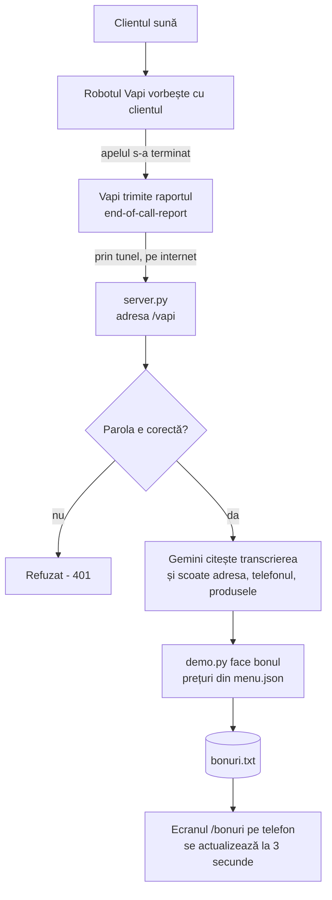

# Primul proiect AI

Primul meu proiect Python, creat în octombrie 2026.

## Ce face proiectul

Un **robot telefonic pentru o pizzerie din Hiltenfingen**:

1. Clientul sună. Robotul **Vapi** vorbește cu el și ia comanda.
2. Când apelul se termină, Vapi trimite convorbirea scrisă (transcrierea) la **serverul nostru** (`server.py`).
3. Serverul o dă lui **Gemini** (AI de la Google), care scoate din ea adresa, orașul, telefonul și produsele.
4. Programul caută produsele în meniu (`menu.json`), calculează prețul și face un **bon în germană**.
5. Bonul se salvează în `bonuri.txt` și apare pe un **ecran pentru telefon** (`/bonuri`), cu sunet la fiecare comandă nouă.

Mai sunt și câteva scripturi mici de exersat (recenzii, test Gemini) — vezi tabelul de mai jos.

## Drumul unei comenzi



Câteva reguli ale bonului:

- **Telefonul** se ia din apel (numărul care a sunat). Ce a spus clientul e doar rezervă.
- **Orașul** se scrie doar dacă clientul l-a spus. Altfel pe bon apare `Ort fehlt`.
- **Mărimea pizzei**: `menu.json` are doar prețul pentru mărimea mică. Dacă clientul cere altă mărime (ex. `groß`), pe bon apare `! Preis prüfen` și pizza aceea **nu intră în total**.
- Produsele care nu sunt în meniu sunt marcate cu `!` și apare `ACHTUNG: Artikel prüfen`.

## Ce îți trebuie

- Python (proiectul are deja mediul virtual `.venv`)
- Un fișier `.env` în folderul proiectului, cu aceste chei (nu-l pune niciodată pe GitHub):

| Cheie | La ce folosește |
|---|---|
| `GEMINI_API_KEY` | Cheia pentru Gemini (AI-ul care citește comanda) |
| `VAPI_API_KEY` | Cheia pentru Vapi (folosită de `demo.py` ca să ia ultimul apel) |
| `VAPI_WEBHOOK_SECRET` | Parola pe care Vapi o trimite la server. Aceeași parolă trebuie pusă și în Vapi |
| `BONURI_KEY` | Cheia pentru ecranul cu bonuri (`/bonuri?cheie=...`) |

## Cum pornești totul

Deschide un terminal (PowerShell) în folderul proiectului.

### 1. Pornește serverul

```powershell
.venv\Scripts\Activate.ps1
python server.py
```

Serverul ascultă la `http://127.0.0.1:5000`. Lasă terminalul deschis.

### 2. Pornește tunelul

Serverul merge doar pe calculatorul tău. Ca Vapi să ajungă la el de pe internet, ai nevoie de un **tunel** — un program care îți dă o adresă publică `https://...` și o trimite la portul 5000.

Deschide **al doilea terminal** și pornește tunelul, de exemplu cu ngrok:

```powershell
ngrok http 5000
```

(sau cu Cloudflare: `cloudflared tunnel --url http://localhost:5000`)

Programul îți arată o adresă de forma `https://ceva-aleator.ngrok-free.app`.

### 3. Spune-i lui Vapi adresa

În Vapi, la asistentul tău, pune **Server URL**:

```
https://ADRESA-TUNELULUI/vapi
```

și parola (secret) — aceeași ca `VAPI_WEBHOOK_SECRET` din `.env`.

> Atenție: la tunelurile gratuite adresa se schimbă de fiecare dată când le repornești. Atunci trebuie s-o schimbi și în Vapi.

### 4. Deschide ecranul cu bonuri pe telefon

```
https://ADRESA-TUNELULUI/bonuri?cheie=CHEIA-DIN-BONURI_KEY
```

Apasă o dată pe „🔔 Ton einschalten” ca telefonul să sune la comenzile noi.

### Fără server: încearcă un bon din terminal

```powershell
python demo.py "Hallo, zwei Pizza Salami an die Hauptstraße 5 in Hiltenfingen, Telefon 0151 123456"
```

Fără text, `demo.py` ia ultimul apel din Vapi. **Atenție:** ambele variante folosesc Gemini (și Vapi), deci consumă din cheile tale.

## Testele

Testele nu folosesc internetul, nu citesc `.env` și nu scriu în `bonuri.txt`. Rulează-le așa:

```powershell
.venv\Scripts\python.exe -m unittest discover -s tests -t .
```

La final trebuie să scrie `OK`.

## Ce fișier face ce

| Fișier | Ce face |
|---|---|
| `server.py` | Serverul web (Flask). Primește apelurile de la Vapi la `/vapi`, verifică parola, face bonul și îl salvează. Arată ecranul `/bonuri` și lista `/bonuri.json`. |
| `demo.py` | „Creierul” bonului: întreabă Gemini ce a comandat clientul, caută produsele în meniu, face bonul în germană. Poate fi rulat și singur din terminal. |
| `bonuri.html` | Ecranul cu bonuri pentru telefon. Se reîncarcă singur la 3 secunde și sună la o comandă nouă. |
| `menu.json` | Meniul pizzeriei: numele produsului și prețul (pentru mărimea mică). |
| `bonuri.txt` | Toate bonurile făcute (se creează singur, nu e pe GitHub — conține date de clienți). |
| `.env` | Cheile și parolele (nu e pe GitHub). |
| `tests/` | Testele automate pentru `demo.py` și `server.py`. |
| `robot.py` | Versiune mai veche: scrii comanda de mână în terminal și primești bonul. |
| `comenzi.py` | Prima versiune: face un bon din textul din `comanda.txt`. |
| `pipeline_recenzii.py` | Două AI-uri unul după altul: primul analizează recenzia din `recenzie.txt`, al doilea scrie un răspuns în germană. |
| `raspuns_recenzii.py` | Versiunea simplă: un singur AI care răspunde la recenzie. |
| `gemini_test.py` | Primul test: verifică dacă merge cheia Gemini. |
| `main.py` | Primul program: scrie „Salut, lume!”. |
